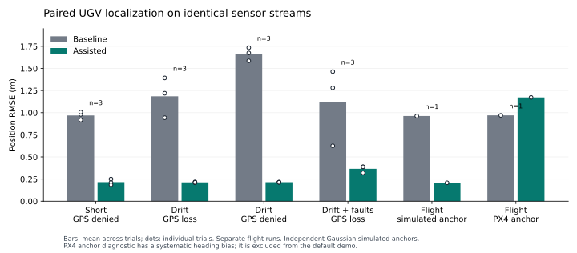

# UGV Localization Evaluation

## Baseline-only short route

The `uav_ugv` Gazebo world runs a 31-second forward-and-turn route. The scorer compares `/ugv/localization/pose` with the `simple_ugv` model's true map pose at matching simulation timestamps. Each row below uses 615 pose samples from 10.5 to 31 seconds. Position error is the 2D distance between estimated and true x/y. The measurement model uses 1.5 m horizontal GPS standard deviation and the wheel and IMU settings in `measurement_model.yaml`.

`on` keeps GPS throughout the route. `off` disables prepared GPS at 10 seconds, after the filter has a GPS fix. `startup_off` disables prepared GPS before the first sensor reading. The UGV keeps publishing wheel and IMU measurements in both GPS-denied cases. The tests use a fresh Gazebo world for each seed and case.

| Seed | GPS case | Mean error (m) | RMSE (m) | 95th percentile (m) | Max (m) | Mean heading error (deg) |
| ---: | --- | ---: | ---: | ---: | ---: | ---: |
| 513 | on | 0.384 | 0.406 | 0.584 | 0.730 | 0.728 |
| 513 | off at 10 s | 0.454 | 0.455 | 0.482 | 0.487 | 0.726 |
| 513 | off from startup | 0.922 | 0.922 | 0.944 | 0.954 | 0.727 |
| 514 | on | 0.298 | 0.328 | 0.627 | 0.722 | 0.721 |
| 514 | off at 10 s | 0.306 | 0.306 | 0.323 | 0.329 | 0.709 |
| 514 | off from startup | 0.999 | 0.999 | 1.016 | 1.022 | 0.709 |
| 515 | on | 0.257 | 0.288 | 0.489 | 0.605 | 0.767 |
| 515 | off at 10 s | 0.116 | 0.116 | 0.131 | 0.143 | 0.712 |
| 515 | off from startup | 1.009 | 1.009 | 1.019 | 1.025 | 0.760 |

Every GPS-off trial publishes zero prepared GPS messages after the switch. Every startup-off trial publishes zero prepared GPS messages throughout. The fused pose continues at 30 Hz in every case.

The GPS-on result is not always the smallest error. In this route, wheel motion is stable while GPS has injected 1.5 m noise; losing GPS after an initial fix can therefore leave a steady estimate. With GPS off from startup, the estimate is about 1 m from truth because the UGV spawns at map x=1 m and the filter receives no global position anchor. The seed controls injected noise, but startup timing can change which readings the filter sees first, so repeated runs vary. These results describe this short simulated route and measurement model. They do not establish real GPS-denied performance or longer-term drift.

The live runner writes per-sample CSV and JSON summaries and accepts another estimate topic and launch file. [Interfaces](interfaces.md#evaluation-and-reproducibility) gives the command and output format.

## Paired baseline and UAV-assisted evaluation

Both filters receive the same wheel, IMU, and GPS messages in one fresh Gazebo world per trial. Only the assisted filter receives UAV-derived x/y. The observer is fixed at map `(2, -2, 4)`. Independent Gaussian noise models relative position, UAV position, and UAV attitude; the anchor passes through the PX4 NED/FRD adapter. [Measurement design](uav_measurement_design.md) specifies the model and assumptions.

### Short route, nominal measurements

The route lasts 31 seconds; metrics cover 10.5-31 seconds. Each estimate contributes 615 matched samples. [JSON summaries and comparison CSV](results/short_nominal/summary.csv) preserve error metrics, sensor counts, and conditions.

| Seed | GPS case | Baseline RMSE (m) | Assisted RMSE (m) | Assisted mean NEES | Assisted 95% coverage |
| ---: | --- | ---: | ---: | ---: | ---: |
| 513 | off | 0.436 | 0.246 | 1.45 | 99.5% |
| 513 | on | 0.401 | 0.241 | 1.45 | 100.0% |
| 513 | startup_off | 0.917 | 0.250 | 1.50 | 99.5% |
| 514 | off | 0.282 | 0.209 | 1.11 | 99.3% |
| 514 | on | 0.303 | 0.214 | 1.21 | 99.3% |
| 514 | startup_off | 0.981 | 0.210 | 1.12 | 99.5% |
| 515 | off | 0.222 | 0.186 | 0.82 | 99.8% |
| 515 | on | 0.311 | 0.189 | 0.89 | 99.0% |
| 515 | startup_off | 1.007 | 0.185 | 0.82 | 99.8% |

All nine paired short trials have lower assisted position RMSE. With no GPS at startup, assistance supplies the missing global anchor: assisted RMSE is 0.185-0.250 m versus 0.917-1.007 m for the baseline. GPS disabled after an initial fix can leave a stable short-route baseline, as the baseline-only table also shows. Separate world runs cannot be compared as identical sensor sequences; the paired trials avoid that mismatch.

NEES is squared x/y error weighted by the EKF covariance. A correctly calibrated independent Gaussian 2D estimate has expected NEES 2 and 95% coverage below 5.991. Samples here are temporally correlated. Coverage near 99% and mean NEES below 2 indicate conservative uncertainty in these conditions; they do not establish calibrated 95% confidence.

### Long route with wheel and heading drift

The route lasts 91 seconds and repeats forward motion, turns, and stops. Metrics cover 10.5-91 seconds. The `drift` profile adds 15% wheel-speed scale error and 0.002 rad/s growing IMU heading bias. These biases deliberately exceed the covariance's independent noise model. Each strategy has 2,389-2,415 matched samples per trial. [Comparison CSV](results/drift/summary.csv) and per-trial JSON summaries store complete metrics.

| Seed | GPS case | Baseline RMSE (m) | Assisted RMSE (m) | Assisted maximum (m) | Assisted mean NEES | Assisted 95% coverage |
| ---: | --- | ---: | ---: | ---: | ---: | ---: |
| 513 | off | 1.393 | 0.218 | 0.531 | 1.16 | 99.8% |
| 513 | on | 0.394 | 0.219 | 0.514 | 1.23 | 99.9% |
| 513 | startup_off | 1.586 | 0.216 | 0.529 | 1.13 | 99.8% |
| 514 | off | 1.219 | 0.208 | 0.478 | 1.08 | 99.5% |
| 514 | on | 0.411 | 0.209 | 0.556 | 1.12 | 98.2% |
| 514 | startup_off | 1.675 | 0.214 | 0.617 | 1.15 | 98.3% |
| 515 | off | 0.943 | 0.213 | 0.627 | 1.10 | 99.2% |
| 515 | on | 0.378 | 0.204 | 0.595 | 1.05 | 99.0% |
| 515 | startup_off | 1.734 | 0.213 | 0.557 | 1.11 | 99.3% |

All nine assisted long trials have lower position RMSE. With GPS lost at 10 seconds, assisted RMSE is 0.208-0.218 m versus baseline 0.943-1.393 m. With GPS denied at startup, assisted RMSE is 0.213-0.216 m versus 1.586-1.734 m. UAV observations supply x/y only: mean heading error remains about 6.1-6.5 degrees in both strategies. Position correction does not establish heading observability.

### Outliers and a UAV observation outage

The 91-second drift route loses GPS at 10 seconds. Every tenth relative sample adds an 8 m body-x outlier. Relative observations stop from route time 35 to 55 seconds; UAV anchor samples continue. Metrics cover the whole 10.5-91 second window, including the outage and recovery. [Comparison CSV](results/robust/summary.csv) and JSON summaries store counts and complete metrics.

| Seed | Baseline RMSE (m) | Assisted RMSE (m) | Assisted maximum (m) | Jump rejections | Assisted 95% coverage |
| ---: | ---: | ---: | ---: | ---: | ---: |
| 513 | 1.280 | 0.388 | 0.738 | 32 | 99.4% |
| 514 | 1.464 | 0.388 | 0.805 | 31 | 99.4% |
| 515 | 0.626 | 0.320 | 0.641 | 38 | 99.8% |

All three assisted fault trials remain below 0.389 m RMSE and 0.806 m maximum error. The baseline reaches 0.626-1.464 m RMSE. The correction resumes after the outage without a filter restart. Counts include the producer's pre-route startup interval and the most recent one-second diagnostic report; they are not exact counts restricted to the scoring window. Nonzero expired counts indicate readings discarded when acquisition-time matching cannot finish within 0.5 seconds.

### Flying UAV and live PX4 anchor diagnostics

A PX4 X500 climbs and hovers while the UGV follows the 31-second nominal route with GPS off from startup. Seed 513 is used; both filters have 615 scored samples. The two rows are separate world runs with paired filters inside each run. They do not share identical sensor sequences across rows.

| UAV anchor source | Baseline RMSE (m) | Assisted RMSE (m) | Assisted mean NEES | Assisted 95% coverage | Stored summary |
| --- | ---: | ---: | ---: | ---: | --- |
| Independent noisy simulated pose | 0.962 | 0.208 | 1.12 | 98.4% | [JSON](results/flight_simulated/trial_live.json) |
| Actual PX4 pose, legacy magnetic path | 0.969 | 1.172 | 24.80 | 0.0% | [JSON](results/live_px4_anchor/trial_live.json) |

The simulated-anchor flight validates full-body rotation, acquisition-time matching, and integration with an actual flying Gazebo model. It does not validate PX4's independent absolute-position accuracy or calibrated perception. This is the default observation model in the goal demo.

The actual PX4 anchor worsens position error and reports overconfident uncertainty. A [timestamp-matched heading check](results/live_px4_anchor/heading_check.json) from PX4's ULog compares `vehicle_attitude` with `vehicle_attitude_groundtruth` over simulation time 55-75 seconds: mean signed NED heading error is 17.94 degrees across 1,111 samples. [Matched heading samples](results/live_px4_anchor/heading_check.csv) preserve the calculation inputs. The pinned magnetometer bridge uses a legacy frame/unit path; the [upstream fix](https://github.com/PX4/PX4-Autopilot/pull/28877) explains that incompatibility. This source bias is not represented by the reported covariance. Updating firmware, model noise, and magnetometer plugin settings requires fresh validation before live PX4 anchors are suitable for navigation.

## Verification and remaining conditions

Both changed ROS packages build. Registered checks report 74 tests, zero failures, and three skipped cppcheck checks caused by the installed cppcheck 2.7 performance issue. Numerical and callback tests cover NED/FRD and ENU/FLU axes, random rotations, covariance lever arms, a 10,000-sample Monte Carlo covariance check within 5%, timestamp interpolation, missing anchors, wrong frames, disabled corrections, outlier recovery, PX4 clock mismatches, resets, and takeoff initialization. Bash runners pass syntax checks. A goal-demo smoke check uses the documented Ogre backend with the GUI and RViz disabled: PX4 confirms Offboard and armed state, and the actual `x500_mono_cam_down_0` model produces timestamped map corrections. The headless Ogre2 renderer crashes in this environment, so that backend is not part of the validated demo configuration. This smoke check does not score navigation accuracy.

The results include 21 paired fixed-observer trials and two flight trials. All GPS-off summaries report zero prepared GPS messages after the switch, and every startup-off summary reports zero prepared GPS throughout. Every accepted trial has at least 500 timestamp-matched samples in the scoring window and at least 50 received UAV corrections. The EKF continues publishing during outages. Coverage is descriptive for correlated samples, and the short baseline's large uncertainty can also cover biased estimates.

Run [the evaluation commands](interfaces.md#evaluation-and-reproducibility) to generate full per-sample UGV CSVs, per-trial JSON, logs, and comparison summaries. Checked-in results keep JSON summaries, comparison CSVs, and the PX4 heading diagnostic. Startup scheduling can change which seeded measurements each filter first sees; exact error values vary between fresh worlds. Within a trial both strategies receive the same UGV messages.

The environment is ROS 2 Humble on Ubuntu 22.04, Gazebo Sim 8.15.0, robot_localization 3.5.4, PX4 `d6f12ad1c4f70ad3230afd7d86e971421e02fef4`, and px4_msgs `86d8239e962f6939e05c3737784f60c02fa884db`. Noise and fault values are controlled simulation assumptions. Physical wheel slip, uneven terrain, shared or persistent UAV/GPS bias, camera visibility, calibrated perception, and closed-loop navigation using the fused pose remain untested.
