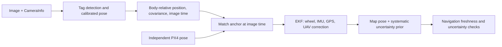

# Calibrated camera observations

## Implemented sensor path

The separately owned `uav_sensing` producer implements the current AprilTag choice; localization retains a sensing-independent relative-position contract. `uav_control` supplies the independent PX4 anchor, and `fault_management` owns simulated corruption and evaluation.

The goal demo and live camera trials use Gazebo camera pixels and `CameraInfo`. The detector subscribes only to `/uav/camera/image` and `/uav/camera/camera_info`. It does not subscribe to simulator poses, UGV estimates, GPS, or UAV odometry. The independent PX4 anchor enters the existing timestamp-matched correction adapter separately.



The UGV carries AprilTag 36h11 ID 7. Its outer black boundary is 0.4 m square, with a 0.5 m white panel. [The generator](../../scripts/generate_fiducial_model.py) creates native Gazebo visuals from the dictionary, avoiding renderer-specific texture materials. The panel is fixed 0.12 m above the chassis origin in both worlds. The UGV models explicitly select `chassis` as canonical link and set the DiffDrive child frame to `simple_ugv/chassis`, so adding a payload cannot silently change the wheel measurement frame. Marker dimensions and mount are known simulation geometry.

The [owned camera model](../../simulation/models/cooperative_camera_uav/model.sdf) includes the aligned upstream X500 and places a downward camera 0.18 m below its FLU body origin. The camera has exact `pi/2` pitch, 1280×960 pixels, 1.74 rad horizontal field of view, 0.1-30 m clipping, and a 5 Hz update rate. PX4 attaches to this model through its supported `PX4_GZ_MODEL_NAME` path. The upstream submodule remains pinned. The mapper receives the owned camera topic through its existing launch parameter.

The camera demo uses a 4.5 m altitude setpoint above PX4's local origin. A roof marker sits above the ground and closer to the camera than the ground plane; its field-of-view margin is therefore smaller than the mapper's ground footprint. The controller holds yaw at zero in PX4 NED, corresponding to north-facing FLU in map. This aligns the wider image dimension with the east-west route. The extra altitude gives the full tag room at both ends of the eight-meter route under that heading. At this height the nominal tag edge is about 50 pixels, above the 12-pixel detection limit. The vector fixture retains its 4 m setpoint; live summaries record the configured value.

[Calibration YAML](../../ros2_ws/src/uav_sensing/config/camera_calibration.yaml) defines body-from-optical rotation/translation and marker-to-chassis offset. Camera optical axes are right/down/forward; body axes are forward/left/up. The owned sensor labels images and calibration `uav/camera_optical_frame`. The detector publishes its static transform from the same calibration and converts the resulting point to `uav/base_link`.

The detector tries adaptive threshold constants 7 and 15, refines tag corners, checks target ID, and solves the metric square pose. It evaluates IPPE square candidates and an iterative homography-initialized candidate. The iterative candidate covers IPPE's numerical singularity at an exactly front-parallel square. Positive depth, finite geometry, minimum 12-pixel edge length, nondegenerate projection, and at most 1.5-pixel RMS coordinate reprojection error are required. Duplicate copies of the target ID are ambiguous and produce no observation.

The output is `/ugv/sensors/uav_relative_pose`, a `PoseWithCovarianceStamped` containing the chassis position and orientation relative to the UAV body. Camera acquisition time is preserved. Joint covariance includes position/orientation correlations and calibrated mounting uncertainty. `/uav/camera/heading_image` shows the measured chassis-forward arrow and is visualization only. Missing targets produce no relative observation and no retained arrow. Wrong frames, missing calibration, bad dimensions/data, and images older than 0.5 seconds are rejected. Processing is limited to 5 Hz. `/diagnostics` reports visibility, fit error, and cumulative counts. [Camera heading](camera_heading.md) defines mounting orientation, uncertainty propagation, and optional heading fusion.

The explicit synthetic vector fixture applies the configured 0.25 m model-to-chassis offset before publishing the same contract. Its model-origin reference is used in the stored fixed-observer/vector flight sections; those scores concern planar x/y on a flat world. Rendered camera trials use the chassis point through the known roof mount.

## Uncertainty assumptions

Projection Jacobians propagate corner uncertainty into pose, then into the offset chassis point and body axes. The pixel covariance includes independent 0.5-pixel corner error, 0.25-pixel principal-point error shared by all corners, and a 0.25-pixel focal-length error shared by both axes. A 1 mm marker-size deviation, 1 cm mount-position deviation, and 0.005 rad mount-angle deviation supply additional covariance. These values are simulation assumptions. The intrinsics and extrinsics come from known simulated geometry; they are not a physical camera calibration.

The calculation is a local approximation conditional on correct target identity and geometry. It does not assign a probability to false identification or multimodal planar orientation. The observation interface supplies position, so the target's unused attitude is not fused into the UGV heading. UAV position and attitude uncertainty are added by the separate correction adapter.

## Shared global position errors

The simulation fault model draws one seeded ENU x/y offset per trial and adds it to both UGV GPS and the UAV anchor. This offset persists for the whole trial. Independent sensor streams keep their existing seeds. Fixed-observer trials alter synthetic anchors; the live demo fault node alters actual PX4 anchor messages while preserving acquisition time, frame, attitude, and reset counters. Flight control continues to use its raw PX4 inputs. Camera pixels and relative measurements are unaffected by this position fault.

`shared_position_stddev` controls injection. `systematic_position_stddev` specifies a separate unreduced global uncertainty prior; it defaults to the injected deviation in test launches. The public fused-pose adapter adds its squared value to x/y covariance. It leaves EKF state and inputs unchanged. A configured 0.8 m standard-deviation prior exceeds the navigation limit and causes a hold even while camera observations and EKF predictions remain fresh. A prior of zero deliberately demonstrates the independent-noise filter's overconfidence under a shared bias.

This prior is configured externally; the system does not infer it from truth or detect arbitrary unknown GNSS bias. Relative sensing cannot recover an unknown translation shared by all absolute references. Physical deployment needs measured calibration uncertainty and a defensible global-reference uncertainty prior, or another independent reference.

## Research and verification

- [OpenCV marker detection](https://docs.opencv.org/4.x/d5/dae/tutorial_aruco_detection.html) defines marker ID and ordered corners. The implementation supports both the installed OpenCV 4.5.4 API and the newer detector API.
- [OpenCV detector parameters](https://docs.opencv.org/4.x/d1/dcd/structcv_1_1aruco_1_1DetectorParameters.html) define the threshold constant. The rendered off-axis fixture motivates the second attempt; dictionary, duplicate-ID, and geometry gates stay the same.
- [OpenCV PnP](https://docs.opencv.org/4.x/d5/d1f/calib3d_solvePnP.html) defines optical projection and IPPE square point order. The front-parallel test motivates the extra iterative candidate.
- [Gazebo DiffDrive implementation](https://github.com/gazebosim/gz-sim/blob/gz-sim8/src/systems/diff_drive/DiffDrive.cc) defines the default child frame from the canonical link. A raw-message check and wheel-count requirements validate the payload integration.
- [CameraInfo contract](https://github.com/ros2/common_interfaces/blob/humble/sensor_msgs/msg/CameraInfo.msg) defines intrinsics, distortion, dimensions, and image acquisition metadata.

Unit checks cover known metric projections, exact front-parallel geometry, body extrinsics, absent/occluded targets, invalid calibration, acquisition time, wrong frames, image data, and a 600-sample position/heading Monte Carlo check with shared principal-point errors. Rendered tests move an opaque visual in front of the real camera, require zero observations during partial/full occlusion, and check recovery, off-axis geometry, and four facing directions. Paired live trials compare both UGV filters on identical sensor messages. Goal trials score physical arrival separately from estimated tolerance. [Heading validation](heading_validation.md) records conditions, outcomes, and limits.

```bash
source /opt/ros/humble/setup.bash
source ros2_ws/install/setup.bash
scripts/run_camera_perception_trial.sh /tmp/camera_visibility
scripts/run_camera_anchor_trials.sh /tmp/camera_anchors
scripts/run_goal_navigation_trial.sh /tmp/camera_goal

# Same persistent bias in GPS and synthetic UAV anchors; known prior retained.
GPS_CASES=on SHARED_POSITION_STDDEV=0.8 \
  scripts/run_cooperative_trials.sh /tmp/shared_bias_bounded

# Deliberately omit the prior for the uncertainty diagnostic.
GPS_CASES=on SHARED_POSITION_STDDEV=0.8 SYSTEMATIC_POSITION_STDDEV=0.0 \
  scripts/run_cooperative_trials.sh /tmp/shared_bias_independent

# Actual PX4 anchor, rendered pixels, biased GPS, and guarded navigation.
INITIAL_GPS_ENABLED=true SHARED_POSITION_STDDEV=0.8 EXPECT_HOLD=true TRIAL_TIMEOUT=600 \
  scripts/run_goal_navigation_trial.sh /tmp/shared_bias_camera_hold
```

Use persistent output directories for retained results. The runners default to the Ogre server backend; they need a valid display session even with the GUI disabled. The fixture and pure image checks do not validate terrain, motion blur, weather, damaged tags, unmarked vehicles, or hardware calibration. The existing luminance-based traversability mapper remains a separate heuristic.
