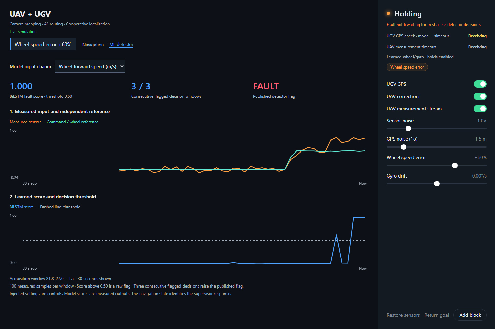

# Demo validation

[Presentation script](demo.md#presentation-script) | [Navigation data](demo_results.json) | [ML data](ml_demo_results.json)

## Configuration

- Runtime: Ubuntu-22.04 WSL, ROS 2 Humble, Gazebo Harmonic, PX4 SITL and MicroXRCEAgent. PX4 arms and takes off with preflight checks enabled.
- Navigation chapter: `simple_goal_demo_complex.sdf`; start (-4, 0), goal (9, 3), return goal (-10, -3); detector decisions are displayed with `fault_hold:=false`.
- ML chapter: `simple_goal_demo.sdf`; start (-4, 0), goal (4, 0); `fault_hold:=true`; wheel-speed scale 1.0 → 1.6 → 1.0. The independent UAV gate remains open during the learned-fault sequence.
- Both chapters use the nominal measurement profile, seed 513, flat simulated ground and explicit injected assumptions. Navigation position, map, route and actuator guards remain active.
- The paired time-domain BiLSTM uses the exported weights and clean-training standardization, 100-sample windows, threshold 0.50 and three distinct consecutive flagged decisions. The autoencoder is disabled. The dashboard displays measured model telemetry and published decisions.
- Truth remains in simulation synthesis, display and scoring. Position errors match acquisition times without extrapolation across missing data. The uncertainty circle is twice the largest reported horizontal standard deviation.

## Navigation run

- The [navigation rehearsal](../scripts/rehearse_demo.py) adds the live box, verifies first arrival with both boxes present, selects the return goal, triples noise, restores noise, disables UGV GPS, disables and restores UAV corrections, and restores sensor controls.
- First arrival occurs **59.084 simulation seconds after navigation starts**, **0.379 m** from the goal in truth, inside the 0.85 m tolerance.
- With UGV GPS off, disabling UAV corrections grows horizontal standard deviation to **0.647 m** and the supervisor enters `HOLD_GUARD` for position uncertainty. Restoring corrections contracts it to **0.130 m** and navigation resumes.
- All eight recorded checks pass. Restore returns the seven sensor settings to nominal and removes the live block. The timed box, integrated bias and filter state remain in the run.
- The driver records 130.040 wall seconds and a final simulation time of 127.480 seconds. The [JSON trace](demo_results.json) contains actions, phase statistics, navigation reasons and detector transitions.

| Phase | Cooperative mean / max error | Baseline mean / max error |
| --- | --- | --- |
| Initial course | 0.043 / 0.099 m | 0.328 / 0.873 m |
| Noise 3x | 0.050 / 0.084 m | 0.481 / 0.970 m |
| Noise restored | 0.045 / 0.063 m | 0.284 / 0.466 m |
| UGV GPS off | 0.031 / 0.060 m | 0.321 / 0.345 m |
| GPS off, UAV corrections off | 0.025 / 0.042 m | 0.307 / 0.329 m |
| GPS off, corrections on | 0.039 / 0.054 m | 0.325 / 0.363 m |
| Sensor settings restored | 0.038 / 0.063 m | 0.586 / 1.303 m |


## Live ML run

- The [ML rehearsal](../scripts/rehearse_ml_demo.py) waits for clean navigation and a score below threshold, injects +60% wheel speed error, records persistence counts 1, 2 and 3, requires a learned fault hold with the pose guard valid, removes the injection, verifies recovery and checks physical goal arrival.
- The wheel class consumes `wheel_odom/vx`. Wheel turn rate supplies no wheel-speed class flag. The gyro class consumes `imu/wz`. Persistence counts distinct acquisition windows and rejects duplicate decision stamps.
- The learned wheel flag and `HOLD_FAULT` occur together while `guard_valid=true`. The hold therefore exercises the detector input to the supervisor. The UAV timeout remains clear throughout that sequence.

| Simulation time | Recorded event | Wheel score | Persistence | Navigation |
| --- | --- | --- | --- | --- |
| 23.740 s | Clean input; +60% injection acknowledged | 0.0000 | 0/3 | NAVIGATE |
| 24.570 s | First captured flagged decision | 0.5993 | 1/3 | NAVIGATE |
| 26.610 s | Second captured flagged decision | 0.9997 | 2/3 | NAVIGATE |
| 27.240 s | Published wheel flag; pose guard valid | 1.0000 | 3/3 | HOLD_FAULT |
| 29.300 s | Wheel speed scale restored to 1.0 | — | — | HOLD_FAULT |
| 35.100 s | Clean decisions and clear interval permit motion | 0.0000 | 0/3 | NAVIGATE |
| 44.960 s | Physical goal tolerance passes | 0.0000 | 0/3 | GOAL |
| 47.060 s | Gated UAV observations trigger timeout | 0.0000 | 0/3 | GOAL |
| 47.720 s | Restored UAV observations clear timeout | 0.0000 | 0/3 | GOAL |

- All eight ML checks pass. The driver records 34.268 wall seconds and a final simulation time of 47.720 seconds. [ML JSON](ml_demo_results.json) contains exact controls, model samples, highlight snapshots and event order. Samples at the same timestamp describe independently delivered diagnostic and supervisor messages.
- The UAV gate forwards raw relative observations to the normal measurement topic while preserving their acquisition stamps. Its service and dashboard control stop and restore forwarding. Missing observations raise the separate two-second `uav_loss` timeout; this rule is distinct from the BiLSTM.
- These two seeded runs demonstrate the recorded course and +60% wheel-speed case on flat simulated ground. The live gyro plot exposes model output; this sequence measures no learned gyro hold. The score supplies no calibrated probability or hardware-accuracy claim.



## Registered and browser checks

- `fault_management`, `mission_manager` and `uav_sensing` build successfully. Their registered checks report **269 checks, zero errors, zero failures and three skipped cppcheck entries**. The installed ament wrapper skips cppcheck 2.7 under its performance exclusion. Python, ROS service, compiled goal and remaining lint checks execute successfully.
- The ROS dashboard check distinguishes a raw flagged window from the published persistent decision and checks stale diagnostics. The model checks cover persistence, duplicate stamps, invalid resets and class mapping.
- Both live views pass browser checks at 1440×960 and 390×844 with no JavaScript errors or horizontal overflow. Desktop controls fit without scrolling. The ML launcher selects its view by default; switching views preserves the live stream. Rejected requests display a reason, and disconnection disables controls.
- Evaluation cleanup stops the owned Gazebo, PX4, MicroXRCEAgent and ROS launch processes, including PX4's separate terminal session. The owned-process check reports zero remaining processes after each chapter.
- The project viewer regression checks actual rendered movement alongside Gazebo truth. At simulation times 58.03 s and 77.20 s, the UGV moves from (1.469, 2.282) m to (3.436, -0.672) m; its blue body moves from screen center (580.8, 384.4) px to (631.2, 458.9) px. The saved editor view remains stationary during the same investigation. The launcher selects the project-owned viewer configuration.
- The viewer regression also runs the registered `simulation_support` and `mission_manager` checks. The workspace report contains **301 tests, zero errors, zero failures and three cppcheck skips**.

```bash
source /opt/ros/humble/setup.bash
cd ros2_ws
colcon build --symlink-install --packages-select fault_management mission_manager uav_sensing
source install/setup.bash
colcon test --executor sequential --packages-select fault_management mission_manager uav_sensing
colcon test-result --verbose
```

## WSL reproduction

- Windows provides editing and Git. Build and run in a fresh WSL scratch copy. Keep existing WSL development checkouts intact.
- In this environment, the Windows PX4 and `px4_msgs` submodules are empty. Reuse the built PX4 dependency tree and copy `px4_msgs` pinned at `109e8c8`.
- Enter Ubuntu from Windows with `wsl -d Ubuntu-22.04 -e bash -lc '<command>'`, then prepare a fresh scratch directory:

```bash
checkout='/mnt/c/Users/Rylan Wade/Desktop/CS513-CPS/uav_ugv_project'
scratch="$HOME/uav-demo-presentation"
mkdir -p "$scratch"
rsync -a --exclude=.git --exclude=external \
  --exclude=ros2_ws/build --exclude=ros2_ws/install --exclude=ros2_ws/log \
  --exclude=ros2_ws/src/px4_msgs --exclude=docs/local_simulator_reinstall \
  --exclude=uav_ugv_project_fault_detection/datasets "$checkout/" "$scratch/"
ln -s "$HOME/uav-dynamic-obstacles/external" "$scratch/external"
cp -a "$HOME/uav-dynamic-obstacles/ros2_ws/src/px4_msgs" "$scratch/ros2_ws/src/"
python3 - "$scratch" <<'PY'
from pathlib import Path
import sys
root = Path(sys.argv[1])
for directory in ('scripts', 'ros2_ws/src', 'simulation', 'config'):
    for path in (root / directory).rglob('*'):
        if path.is_file():
            data = path.read_bytes()
            if path.suffix in ('.py', '.sh', '.yaml', '.yml', '.sdf', '.html', '.xml') or data.startswith(b'#!'):
                path.write_bytes(data.replace(b'\r\n', b'\n'))
PY
source /opt/ros/humble/setup.bash
cd "$scratch/ros2_ws"
colcon build --symlink-install
cd "$scratch"
DISPLAY=:0 ROS_DOMAIN_ID=73 GZ_PARTITION=demo_presentation_73 \
  setsid timeout -k 15s -s INT 480s ./scripts/run_demo.sh
```

- Keep the launch in the foreground so the Windows WSL invocation remains alive. Use an unused ROS domain and Gazebo partition for each run.
- In a second Linux terminal, run `python3 scripts/rehearse_demo.py --output localization_results/navigation_take`. The destination must be a new directory. The dashboard runs without Node.
- For chapter 2, stop the owned chapter-1 processes, launch `./scripts/run_ml_demo.sh` with an unused domain and partition under the same `setsid timeout` wrapper, reload the page, and run `python3 scripts/rehearse_ml_demo.py --output localization_results/ml_take`.
- Inspect live data with `curl --max-time 3 http://127.0.0.1:8765/state` and the event trace with `curl --max-time 3 http://127.0.0.1:8765/events`.
- After Ctrl+C or the timeout, check the processes belonging to that invocation and partition. PX4's `script` wrapper creates a separate session; stop every remaining owned descendant.
