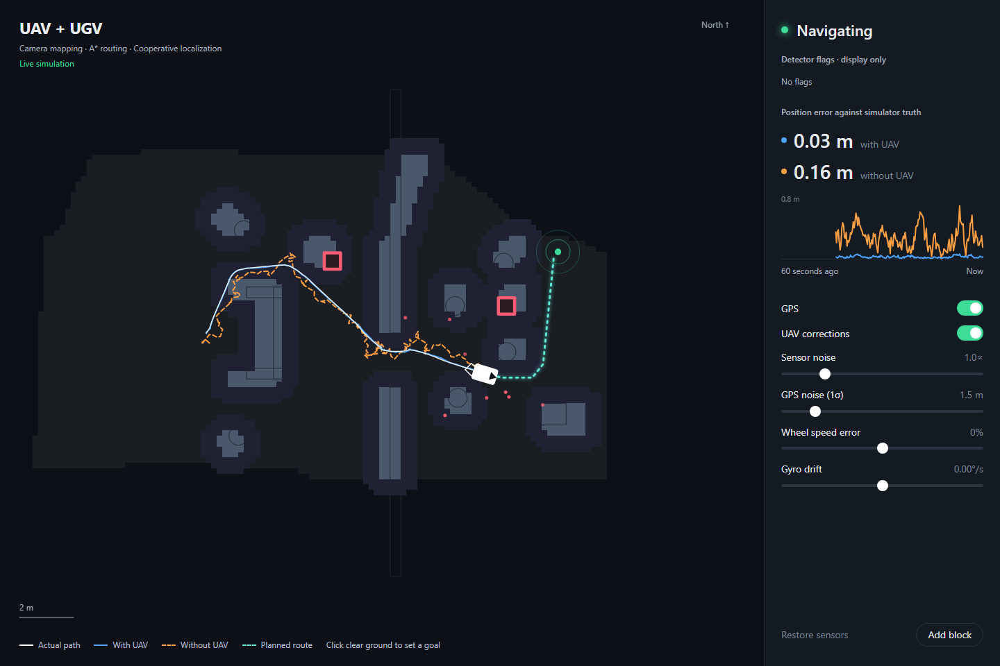

# Complex demo review validation

[Demo and presentation script](demo.md) | [Machine-readable result](demo_review_result.json)

The review evaluates branch `feat/complex-demo` from base commit `5990c7b` on 2026-11-23, with the accompanying dashboard and atomic-goal changes. Runtime is Ubuntu-22.04 in WSL, ROS 2 Humble, Gazebo Harmonic, PX4 SITL and MicroXRCEAgent. The first workspace build completes all 12 packages. The review uses seed 513, the nominal measurement profile, `fault_hold:=false`, `start_rviz:=false`, ROS domain 173 and Gazebo partition `review_5990c7b_173`.

## Full run

The retained JSON contains every HTTP action and its acknowledged result, goal truth position, and acquisition-matched position-error summaries. Times are simulation seconds relative to the dashboard's first truth sample; navigation is first observed by the monitor at 21.85 s. The monitor polls every 0.5 wall seconds, so event observation times have polling latency.

- PX4 arms and takes off with the 0.8 m spawn keep-out. The initial “no heading reference” warning clears. No preflight checks are bypassed. An obstacle edge under the UAV explains the earlier tilt/attitude failure; the generator now also rejects an obstacle covering the spawn.
- A dashboard block is accepted at 32.28 s, at (0.67, 2.66). The scheduled box appears at (7.1, 1.0). Both are present at first arrival.
- First goal completion is observed at 89.84 s, 67.99 s after the first navigation observation. Simulator truth is (8.9412, 2.6304), 0.3742 m from (9, 3), inside the declared 0.85 m physical tolerance.
- A new goal (-4, -3) is acknowledged and navigation continues. All sensor-control requests are acknowledged by their ROS services.
- Restore succeeds, removes the live block, returns all six settings to nominal, and preserves the error history. The timed scenario box remains.
- Evaluation stops all owned Gazebo, PX4, MicroXRCEAgent and ROS launch processes. Process cleanup targets the recorded session and unique partition, including PX4's separate terminal session; it does not kill unrelated simulations.

| Phase | Duration | Cooperative mean / max error | GPS/wheel/IMU mean / max error |
| --- | --- | --- | --- |
| Initial course, GPS on | About 68 s | 0.031 / 0.082 m | 0.354 / 0.871 m |
| Noise 3×, GPS on | About 15 s | 0.040 / 0.109 m | 0.473 / 1.026 m |
| GPS off, otherwise nominal | About 20 s | 0.026 / 0.058 m | 0.232 / 0.262 m |
| GPS off, speed +20%, gyro +2°/s | About 20 s | 0.380 / 0.627 m | 0.849 / 1.171 m |
| Same faults, corrections disabled | About 20 s | 0.563 / 0.590 m | 1.106 / 1.133 m |
| Corrections restored, faults continue | About 30 s | 0.536 / 0.564 m | 1.078 / 1.106 m |

The combined-fault phases include braking and stationary holds, so these rows do not establish successful continuous navigation under those faults. The GPS flag appears in this run; learned flags are not ground-truth fault labels.

After assistance is restored, the correction producer's accepted/heading-accepted counts increase from 623 to 763 over about 29 wall seconds. Matching and publication resume, while position error stays elevated. This places the observed recovery limit downstream of matching. The joint pose innovation gate is a plausible explanation given the accumulated gyro bias and the configured five-sigma rejection; internal EKF rejection telemetry is not recorded, so that explanation remains an inference. The review preserves the gates and uncertainty guard. Restoring a gyro bias **rate** does not erase its accumulated angle.

## Checks

The changed ROS packages are `fault_management` and `mission_manager`. Their registered checks include numerical dashboard tests, real HTTP-to-ROS service tests for atomic goal batches and service rejection, direct compiled goal-manager tests for complete/partial/invalid parameter batches, sensor tests, the verification suite and package linters. The hazard assessment check now supplies its verification import path itself.

`colcon test-result --verbose` reports **234 checks, 0 errors, 0 failures, 3 skipped**. The three skips are cppcheck entries for the C++ source, header and test: the installed ament checker skips cppcheck 2.7 because of its known performance issue. The compiled goal-manager test and remaining registered checks execute successfully.

```bash
source /opt/ros/humble/setup.bash
cd ros2_ws
colcon build --symlink-install --packages-select fault_management mission_manager
source install/setup.bash
colcon test --executor sequential --packages-select fault_management mission_manager
colcon test-result --verbose
```

Browser checks use a live simulation at 1440×960 and 390×844: no JavaScript errors or horizontal overflow, the desktop controls fit without scrolling, rejected block placement exposes its reason, and a disconnected server changes the displayed state and disables controls. The mobile layout stacks the map above the controls. No Node runtime is required by the dashboard.



## WSL reproduction

Windows provides editing and Git. Keep existing WSL source checkouts intact. This environment has empty PX4/`px4_msgs` submodules on Windows; the existing built PX4 tree and `px4_msgs` revision `109e8c8` provide those dependencies.

From Windows, enter Ubuntu with `wsl -d Ubuntu-22.04 -e bash -lc '<command>'`. In that distro, use a **fresh** scratch directory, for example:

```bash
checkout='/mnt/c/Users/Rylan Wade/Desktop/CS513-CPS/uav_ugv_project'
scratch="$HOME/uav-demo-check"
mkdir -p "$scratch"
rsync -a --exclude=.git --exclude=external \
  --exclude=ros2_ws/build --exclude=ros2_ws/install --exclude=ros2_ws/log \
  --exclude=ros2_ws/src/px4_msgs --exclude=docs/local_simulator_reinstall \
  --exclude=uav_ugv_project_fault_detection/datasets "$checkout/" "$scratch/"
ln -s "$HOME/uav-dynamic-obstacles/external" "$scratch/external"
cp -a "$HOME/uav-dynamic-obstacles/ros2_ws/src/px4_msgs" "$scratch/ros2_ws/src/"
python3 - "$scratch" <<'PY'
from pathlib import Path
import sys
root = Path(sys.argv[1])
for directory in ('scripts', 'ros2_ws/src', 'simulation', 'config'):
    for path in (root / directory).rglob('*'):
        if path.is_file():
            data = path.read_bytes()
            if path.suffix in ('.py', '.sh', '.yaml', '.yml', '.sdf', '.html', '.xml') or data.startswith(b'#!'):
                path.write_bytes(data.replace(b'\r\n', b'\n'))
PY
source /opt/ros/humble/setup.bash
cd "$scratch/ros2_ws"
colcon build --symlink-install
cd "$scratch"
DISPLAY=:0 ROS_DOMAIN_ID=73 GZ_PARTITION=demo_check_73 \
  setsid timeout -k 15s -s INT 480s ./scripts/run_demo.sh start_rviz:=false
```

The first `px4_msgs` build takes several minutes. Choose unused domain/partition values for each evaluation. The command remains in the foreground so the WSL invocation stays alive. In another terminal, `curl --max-time 3 http://127.0.0.1:8765/state` inspects the run. Perform the actions in [the presentation script](demo.md#presentation-script); the retained result gives the exact action values and times for this review.

Use Ctrl+C after evaluation, then check the processes belonging to that invocation and partition. A bounded launch timeout does not prove every descendant has exited; PX4's `script` wrapper creates a separate session. Stop any remaining owned descendants before starting another run.
