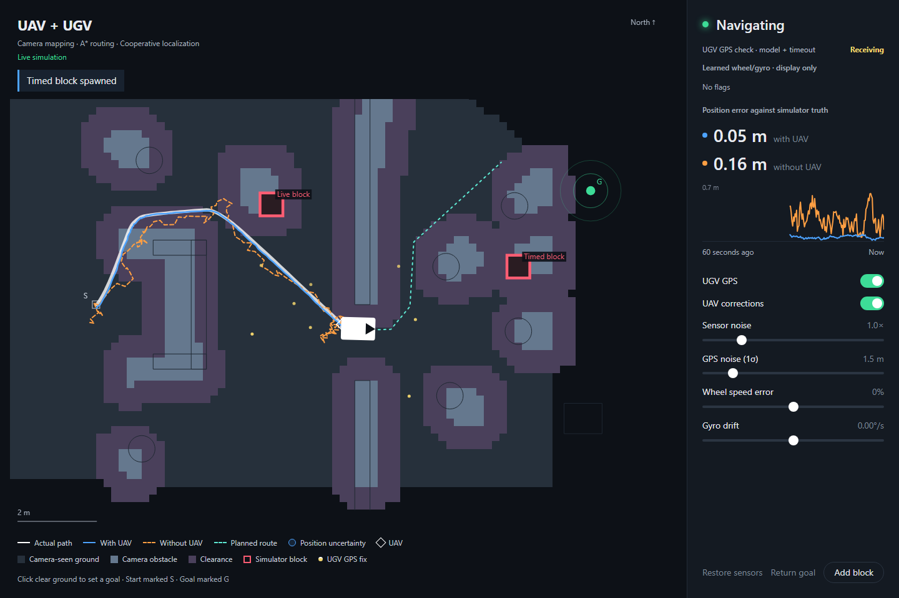

# Demo validation

[Presentation script](demo.md#presentation-script) | [Recorded results](demo_results.json) | [Rehearsal driver](../scripts/rehearse_demo.py)

## Configuration

- Runtime: Ubuntu-22.04 WSL, ROS 2 Humble, Gazebo Harmonic, PX4 SITL and MicroXRCEAgent.
- Course: `simple_goal_demo_complex.sdf`; initial goal (9, 3); return goal (-10, -3).
- Measurement profile: nominal, seed 513, flat simulated ground, explicit injected noise and faults.
- Detector decisions: display only (`fault_hold:=false`). Navigation position, map, route and actuator guards remain active.
- Dashboard errors interpolate truth and estimates at acquisition times, without extrapolation across missing data. The displayed uncertainty is twice the largest horizontal standard deviation.

## Executed sequence

- The [rehearsal driver](../scripts/rehearse_demo.py) executes the same controls and observation intervals as the presentation script. It records every acknowledged action, navigation transition, hold reason and changed detector flag.
- PX4 arms and takes off with its preflight checks enabled. Both the live block and timed block are present at first arrival.
- First arrival occurs 63.936 simulation seconds after navigation starts. Truth is 0.306 m from the goal, inside the 0.85 m physical tolerance.
- With UGV GPS off, disabling UAV corrections grows horizontal standard deviation to 0.649 m. Re-enabling corrections contracts it to 0.118 m and navigation resumes.
- Combined wheel and gyro faults trigger the position-uncertainty guard while the robot is on the return route. The held truth position is 2.441 m from the return goal. The hold precedes return arrival.
- Restore returns the six sensor settings to nominal and removes the live block. The timed block, integrated bias and filter state remain in the run.
- The run records 180.850 wall seconds and 169.250 simulation seconds. The recording plan trims waiting while preserving action order.

| Phase | Cooperative mean / max error | Baseline mean / max error |
| --- | --- | --- |
| Initial course | 0.042 / 0.097 m | 0.338 / 0.870 m |
| Noise 3x | 0.038 / 0.060 m | 0.460 / 0.859 m |
| Noise restored | 0.037 / 0.057 m | 0.547 / 0.827 m |
| UGV GPS off | 0.060 / 0.091 m | 0.521 / 0.559 m |
| GPS off, UAV corrections off | 0.094 / 0.116 m | 0.535 / 0.562 m |
| GPS off, corrections on | 0.046 / 0.121 m | 0.566 / 0.593 m |
| Wheel speed error +20% | 0.034 / 0.074 m | 0.642 / 0.828 m |
| Wheel error and gyro +2 deg/s | 0.794 / 1.140 m | 2.133 / 2.554 m |
| Sensor settings restored | 0.564 / 1.653 m | 0.685 / 2.795 m |

- The [JSON timeline](demo_results.json) contains the control, navigation and flag transitions for these measurements. Phase summaries include error variation and reported uncertainty. Raw samples are saved alongside `summary.json` by the rehearsal driver.
- Learned wheel/gyro outputs and the missing-GPS check are separate from the known injected settings. The model emits a wheel flag during nominal movement and leaves wheel/gyro flags clear during the combined injection. The script states these outputs; the position guard supplies the recorded hold.
- These measurements describe one seeded run on flat ground. They establish the recorded demo behavior, not hardware accuracy or general fault tolerance.

## Registered checks

- The touched ROS package is `fault_management`; `mission_manager` is also built and checked with the assembly.
- `colcon test-result --verbose` reports **236 checks, zero errors, zero failures, and three skipped cppcheck entries**. The installed ament wrapper skips cppcheck 2.7 because of its performance exclusion. Registered Python, ROS service, compiled goal and remaining lint checks execute successfully.
- The live browser checks at 1440×960 and 390×844 report no JavaScript errors or horizontal overflow. The desktop controls fit without scrolling. The map key distinguishes perception, simulator placement, GPS fixes, tracks and uncertainty. Failed requests display their reason; a disconnected page disables controls.
- Evaluation cleanup stops the owned Gazebo, PX4, MicroXRCEAgent and ROS launch processes, including PX4's separate terminal session.

```bash
source /opt/ros/humble/setup.bash
cd ros2_ws
colcon build --symlink-install --packages-select fault_management mission_manager
source install/setup.bash
colcon test --executor sequential --packages-select fault_management mission_manager
colcon test-result --verbose
```



## WSL reproduction

- Windows provides editing and Git. Build and run in a fresh WSL scratch copy. Keep existing WSL development checkouts intact.
- In this environment, the Windows PX4 and `px4_msgs` submodules are empty. Reuse the built PX4 dependency tree and copy `px4_msgs` pinned at `109e8c8`.
- Enter Ubuntu from Windows with `wsl -d Ubuntu-22.04 -e bash -lc '<command>'`, then prepare a fresh scratch directory:

```bash
checkout='/mnt/c/Users/Rylan Wade/Desktop/CS513-CPS/uav_ugv_project'
scratch="$HOME/uav-demo-presentation"
mkdir -p "$scratch"
rsync -a --exclude=.git --exclude=external \
  --exclude=ros2_ws/build --exclude=ros2_ws/install --exclude=ros2_ws/log \
  --exclude=ros2_ws/src/px4_msgs --exclude=docs/local_simulator_reinstall \
  --exclude=uav_ugv_project_fault_detection/datasets "$checkout/" "$scratch/"
ln -s "$HOME/uav-dynamic-obstacles/external" "$scratch/external"
cp -a "$HOME/uav-dynamic-obstacles/ros2_ws/src/px4_msgs" "$scratch/ros2_ws/src/"
python3 - "$scratch" <<'PY'
from pathlib import Path
import sys
root = Path(sys.argv[1])
for directory in ('scripts', 'ros2_ws/src', 'simulation', 'config'):
    for path in (root / directory).rglob('*'):
        if path.is_file():
            data = path.read_bytes()
            if path.suffix in ('.py', '.sh', '.yaml', '.yml', '.sdf', '.html', '.xml') or data.startswith(b'#!'):
                path.write_bytes(data.replace(b'\r\n', b'\n'))
PY
source /opt/ros/humble/setup.bash
cd "$scratch/ros2_ws"
colcon build --symlink-install
cd "$scratch"
DISPLAY=:0 ROS_DOMAIN_ID=73 GZ_PARTITION=demo_presentation_73 \
  setsid timeout -k 15s -s INT 480s ./scripts/run_demo.sh
```

- Keep the launch in the foreground so the Windows WSL invocation remains alive. Use an unused ROS domain and Gazebo partition for each run.
- In a second Linux terminal, run `python3 scripts/rehearse_demo.py --output localization_results/demo_take`. The destination must be a new directory. The dashboard runs without Node.
- Inspect live data with `curl --max-time 3 http://127.0.0.1:8765/state` and the event trace with `curl --max-time 3 http://127.0.0.1:8765/events`.
- After Ctrl+C or the timeout, check the processes belonging to that invocation and partition. PX4's `script` wrapper creates a separate session; stop every remaining owned descendant.
