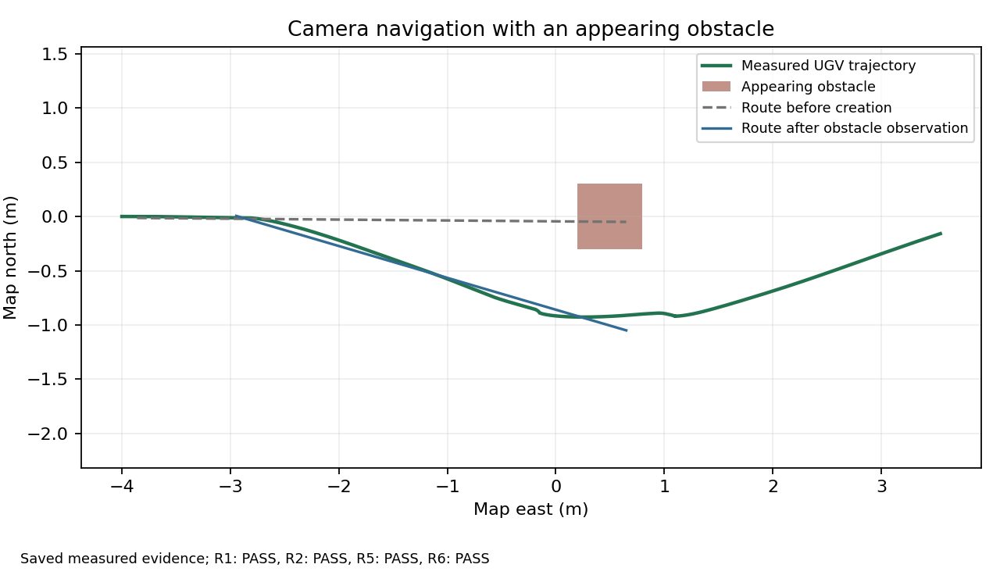

# Dynamic obstacle example

Date: 2026-11-11. [Technical guide](../../../dynamic_obstacles/README.md) | [Completion plan W2/W3](../../completion_plan.md)

One dark 0.6 ? 0.6 ? 0.4 m box appears at map (0.5, 0) after the first drive command. The UAV camera supplies the map update, the existing planner reroutes, and the UGV reaches the original goal. Scenario/truth geometry is used for mutation and scoring, never as a navigation input.



The blue line is the first selected route after observation; routes may be camera-supported prefixes. The green trajectory includes subsequent replans through arrival. This figure displays saved measurements, not a surrogate trajectory.

## Measured results

| Check | Result |
| --- | --- |
| Final example | Seed 744; R1/R2/R5/R6 PASS; source unchanged throughout the run |
| Hazard evidence | Planned, observer-reported, and recorded operation IDs all match |
| Camera observation | 6 occupied footprint cells; prior footprint is observed free; prior route is blocked by the new box |
| Observation eligibility | Distance lower bound 3.205 m exceeds the required 2.330 m |
| R5 response | 0.140 simulation seconds against the declared 2 s bound |
| R1 sampled disk clearance | Minimum 0.098 m; zero sampled violations |
| R2 arrival | 39.480 simulation seconds from the declared first-drive interval |
| R6 conditional position error | RMSE 0.035 m; maximum 0.079 m |
| Runtime | 78.798 wall seconds including startup, scoring, and cleanup |
| Numerical/registered checks | 142 offline tests; 283 registered Linux checks, zero errors/failures, eight static-analysis skips |
| Gazebo lifecycle | Five creation/duplicate/removal/respawn checks pass in a private world |
| Cancellation | Exit 130 after confirmed creation; recorder and both new nodes close; zero owned process groups remain |

The profile is provisional. Camera R3 is unexercised and inconclusive; R4/R7/R8 are excluded from this navigation example. These results cover one flat-world box scenario, not general dynamic obstacle avoidance or continuous physical safety.

## Evidence

- [Final summary](example/summary.json), [evaluated requirements](example/evaluation/result.json), and [legacy arrival scorer](example/run/results.json).
- [Frozen source/input metadata](example/freeze.json), [scenario](example/scenario.yaml), [observer parameters](example/observer_parameters.yaml), and [bound profile](example/evaluation_profile.yaml).
- [Applied operations](example/run/hazards/scenario_result.json), [map observations](example/run/hazards/observation_result.json), and [timeline CSV](report/timeline.csv).
- [Recorder/source metadata](example/run/verification/recording.json), [normalized input manifest](example/input_manifest.json), and [source equivalence](source_equivalence.json).
- [Gazebo lifecycle result](lifecycle.json), [interruption result](interruption.json), [registered checks](colcon-results.txt), and [validation metadata](validation.json).
- [Numerical plot data](report/evidence.json), [PNG](report/navigation.png), [SVG](report/navigation.svg), and [PDF](report/navigation.pdf).

Reproduce the saved report without ROS or source bags:

```bash
python scripts/report_dynamic_obstacle_trial.py \
  docs/project/results/dynamic_obstacles/report verification/outputs/obstacle-report-replay
```

The report retains saved verdicts; it does not recompute requirement checks from display points. Raw bags and full normalized traces remain machine-local at `Ubuntu-22.04:/home/rylanwwade/uav-dynamic-obstacles/evidence/release`. [Raw availability](raw_availability.json) identifies bag/source-archive hashes and sizes. The source archive retains the exact runtime bytes, and all 236 recorded source files match the checkout.

## Development and baseline outcomes

[Development cohorts](development_pilots.json) remain separate. Two earlier runs avoid the obstacle and reach the goal but fail the conservative observation-distance qualification, so R5 remains inconclusive. The final example changes the obstacle placement to provide more distance; verification bounds stay unchanged. Successful development cohorts are superseded and are not pooled into a success-rate claim.

The [ordinary demo regression](baseline_demo.json) retains an inconclusive startup: its guard fixture [times out waiting for command delivery](baseline_guard_startup.txt). Camera R1/R2/R6 and both watchdog R4 recordings pass, as recorded in the [ledger](baseline_ledger.json). An [isolated guard replay](guard_replay.json) then passes all 23 cases. The startup outcome is retained rather than counted as a completed guard test.

W2/W3 infrastructure and this small camera example are implemented. Multi-layout coverage, extensive hazard sweeps, moving obstacles, and ten-run response characterization remain outside this result.
