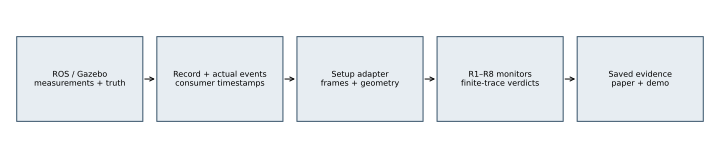
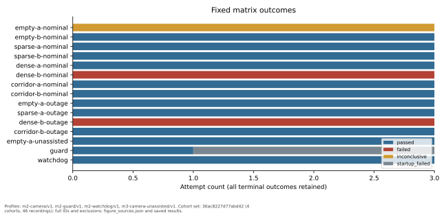
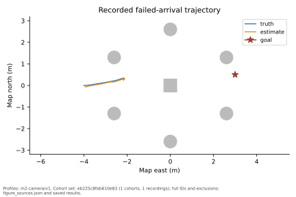
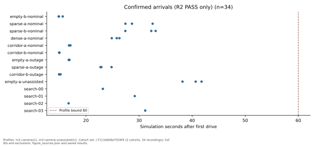
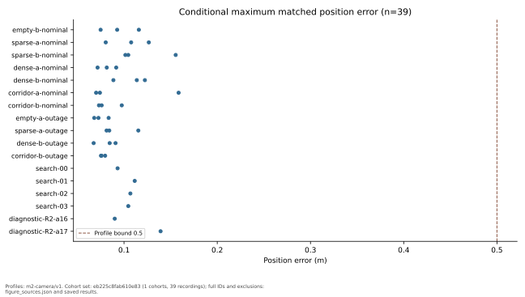
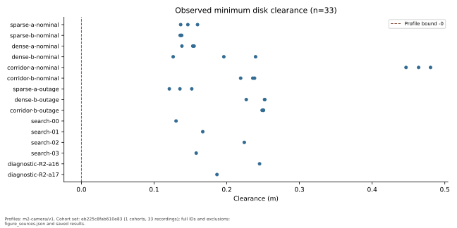
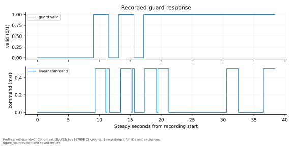
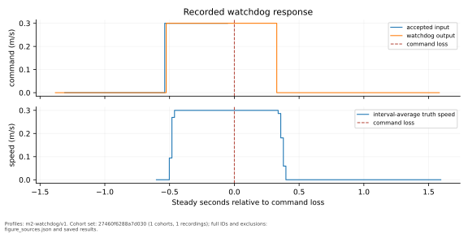

# Recorded verification of UAV–UGV navigation

## Scope and architecture

This report evaluates recorded behavior of the existing ROS 2 Humble/PX4/Gazebo system. It separates numerical requirement monitors from simulator-specific recording, frames, geometry, and consumer receipt instrumentation. Simulator truth is used for sensor synthesis and scoring, not as navigation input. The supported footprint is a planar disk in ENU map coordinates; obstacles are independent static upright boxes and cylinders.

## Requirements and method

R1 checks sampled disk clearance; R2 checks bounded arrival with physical and estimated tolerances plus quiet dwell; R3 checks bounded response and sustained zero commands after an actual invalid guard; R4 separates actuator-output expiry from measured physical settling; R6 acquisition-matches pose error conditional on fresh UAV input and valid pose. Availability follows the exported profiles and capability table. Planned exclusions are {"R5": "No hazard-event producer is available.", "R7_R8": "No online detector exists; enabled/disabled/forced-miss comparisons are unavailable.", "combinations": "Outage trials use goal A for empty/sparse and goal B for dense/corridor; both goals have nominal trials in every layout.", "seeds": "Seeds configure synthetic sensor corruption; PX4/render scheduling is not deterministic."}. No discrete supervisor proof is implemented.

| Requirement | Recorded-trace condition |
| --- | --- |
| R1 | `G_valid(d_clear >= -contact_tolerance)` over sampled disk clearances. |
| R2 | `F_[0,arrival_deadline] completed_arrival_dwell`, with the declared dwell inside both tolerances and quiet commands. |
| R3 | `G(invalid_guard -> F_[0,guard_deadline](quiet AND (quiet W guard_valid)))`. |
| R4 | Profile-bounded output expiry and physical settling onset, confirmed by the declared quiet dwell. |
| R6 | `G((fresh_uav AND valid_pose) -> matched_error <= error_limit)`. |

`W` denotes weak until: a quiet hold can continue to the declared recording end without requiring recovery. These formulas summarize the calibrated profiles; source profiles and saved parameters remain authoritative.

Clocks are partitioned by domain and epoch. Integer acquisition stamps are preserved. Consumer receipt, command publication, actuator receipt/output, and physical motion remain separate observations. Bounded response windows include the deadline. Missing coverage, untriggered response obligations, and insufficient future horizons remain inconclusive. Physical motion uses interval-average truth differences and sampling uncertainty; a paused simulator cannot establish settling. Verdicts come from full-resolution saved evaluations. Figure series are downsampled display inputs.

## Experiment design and provenance

The frozen matrix contains 45 planned attempts and 45 attempted cases. The ledger retains 51 attempts including search/replay, 52 result recordings, and 4 distinct profile/evaluator/source cohorts. Outcomes are {"failed": 8, "inconclusive": 3, "passed": 38, "startup_failed": 2}. Every attempt is retained, including startup failure, timeout, interruption, and invalid/incomplete data. Counts are descriptive; predetermined seeds do not establish a strong success-probability bound. Deterministic fixture repetitions are repeatability checks. Recorded factors are {"goals": [[3.0, 0.5], [4.0, 0.0]], "layouts": ["simple_goal_demo", "simple_goal_demo_corridor", "simple_goal_demo_dense", "simple_goal_demo_sparse"], "seeds": [631, 632, 633]}.

Matrix factors, seed pairing, excluded combinations, budgets, frozen source files, profile hashes, source-run IDs, and exact commands are retained in the exported campaign and ledger. Calibration assumptions and evaluated source-run identities remain explicit. Assistance-disabled comparisons exclude R6 rather than inventing UAV observations. No detector-enabled/disabled/forced-miss comparison is claimed. `assistance_comparisons.csv` retains 3 seed/world/goal/outage pairs, both attempt outcomes, and available arrival metrics. Missing or failed startup evidence prevents a navigation-benefit claim for that pair.

## Results

Unmeasured requirements: R5, R7, R8. The exact evaluated bounds are retained in `bounds.csv` and individual results.

| requirement | PASS | FAIL | INCONCLUSIVE | NOT_APPLICABLE | triggers |
| --- | --- | --- | --- | --- | --- |
| R1 | 43 | 0 | 2 | 7 | 0 |
| R2 | 34 | 8 | 3 | 7 | 43 |
| R3 | 1 | 0 | 45 | 6 | 6 |
| R4 | 6 | 0 | 0 | 46 | 6 |
| R5 | 0 | 0 | 0 | 52 | 0 |
| R6 | 39 | 0 | 3 | 10 | 40901 |
| R7 | 0 | 0 | 0 | 52 | 0 |
| R8 | 0 | 0 | 0 | 52 | 0 |

These are descriptive totals across matrix, search, and replay recordings in the listed cohorts, not a pooled success probability. `claims_by_category.csv` separates those categories. Available measured ranges are:

| metric | recordings | minimum | maximum | unit |
| --- | --- | --- | --- | --- |
| minimum_clearance_m | 33 | 0.121 | 0.480 | m |
| arrival_s | 34 | 14.868 | 41.780 | simulation s |
| conditional_rmse_m | 39 | 0.024 | 0.086 | m |
| maximum_position_error_m | 39 | 0.067 | 0.159 | m |
| guard_response_ms | 1 | 0.138 | 0.138 | steady ms |
| watchdog_expiry_ms | 6 | 366.106 | 381.620 | steady ms |
| physical_settling_ms | 6 | 426.636 | 454.561 | steady ms |

The metric counts include only recordings with a measured value and a decided requirement verdict. All other attempted outcomes remain in the ledger and outcome table. Witnessed counterexamples include:

| case_id | requirement | reason |
| --- | --- | --- |
| dense-b-nominal-s631 | R2 | goal_deadline_missed |
| dense-b-nominal-s632 | R2 | goal_deadline_missed |
| dense-b-nominal-s633 | R2 | goal_deadline_missed |
| dense-b-outage-s631 | R2 | goal_deadline_missed |
| dense-b-outage-s632 | R2 | goal_deadline_missed |
| dense-b-outage-s633 | R2 | goal_deadline_missed |
| diagnostic-R2-a16 | R2 | goal_deadline_missed |
| diagnostic-R2-a17 | R2 | goal_deadline_missed |

`violations.csv` retains every stored witness; this excerpt lists at most ten. Original failures and fresh-world replays remain separate.

Arrival points include only R2 PASS recordings; unsuccessful and incomplete attempts remain in the outcome table and ledger. Physical arrival uses each profile's declared physical tolerance, which can differ from its estimated-pose tolerance. `bounds.csv` retains every evaluated parameter set. Conditional localization values retain fresh-UAV/guard eligibility and matched sample coverage.

Empty worlds have no finite nearest-obstacle clearance and are excluded from the scalar search objective. Negative clearance is a sampled disk-proxy overlap; it is not a continuous-time proof or a claim about exact rigid-body contact.

Guard and watchdog latency values are in `metrics.csv`; display curves do not recompute their verdicts. Physical settling is distinct from requested or actuator-emitted zero commands.

## Failure search and replay

The campaign records 4 search attempts and 274.824 measured search driver wall seconds, plus 0 search-counterexample replays and 2 supplemental diagnostic replays in fresh worlds. Search minimizes one declared objective, sampled R1 clearance. Missing evidence has no objective value. Original failures remain alongside replays; identical seeds need not reproduce the same feedback trajectory. Post-hoc diagnostics remain separate from the held-out matrix and original search budget. The exact budget and each outcome remain in the ledger. No counterexample within a finite budget is not proof of safety.

## Claims and limits

`claims.csv` binds each requirement's counts, trigger coverage, evidence, and limitation. Evidence paths are relative to the portable campaign root. No result establishes general safety outside the recorded envelope, continuous-time collision freedom, an online detector benefit, hazard-response performance, or a discrete supervisor proof. Unsupported capabilities remain unavailable. Source snapshots and profile/evaluator hashes prevent pooling incompatible code or thresholds. Failed and incomplete attempts remain in every relevant denominator.

## Reproduction

Regenerate this report from the portable campaign export without ROS or raw bags using `python scripts/verification_report.py CAMPAIGN OUTPUT`. Raw recordings remain at the archive path in `campaign.json`, with source checksums and an explicit availability note. Live and recorded-replay demo commands are documented in `docs/verification/demo.md`. The numerical tables are deterministic for these saved results; plots identify their source recordings in `figure_sources.json`.

## References

- `docs/verification/requirements.md`: executable R1–R8 definitions and finite-trace semantics.
- `docs/verification/interfaces.md`: normalized records and saved-result contracts.
- `docs/verification/experiments.md`: fixed matrix, search budget, isolation, cleanup, and resume behavior.
- `docs/project/results/verification/m2/README.md`: calibration conditions and unavailable capabilities.
